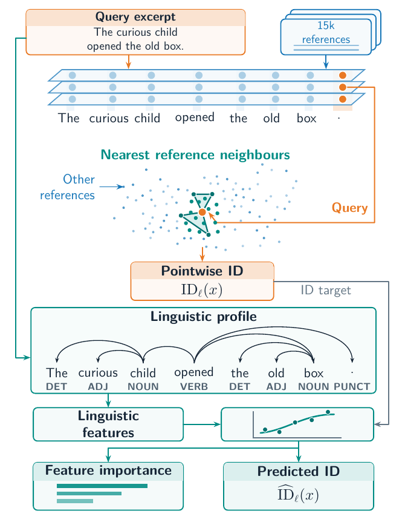

# Linguistic Features of Local Geometry in Language Models

**Lucia Domenichelli · Iuri Macocco · Dominique Brunato · Felice Dell’Orletta · Marco Baroni**

Data, analyses, and an interactive explorer for *Linguistic Features of Local Geometry in Language Models*.

The study examines how linguistic features of text relate to the local geometry of representations in Pythia, Qwen, and Apertus.

## Explore the texts and results

Browse 2,000 excerpts, compare results across language models, and download figures, tables, and data on the [project website](https://ldomenichelli.github.io/linguistic-features-of-local-geometry-in-language-models/).

## Paper results

Find the [current figures and tables](paper/current/README.md) and [earlier supporting analyses](paper/README.md).



## Install and rebuild

Requires Python 3.10 or later.

```bash
python3 -m venv .venv
.venv/bin/python -m pip install -r requirements-analysis.txt
make PYTHON=.venv/bin/python paper
make PYTHON=.venv/bin/python site
make PYTHON=.venv/bin/python check
```

These commands rebuild the analysis figures and tables, prepare the website, and run the checks. To view the site locally, run `make serve` and open <http://localhost:8765>.

To rerun the prediction analyses:

```bash
make PYTHON=.venv/bin/python analysis
make PYTHON=.venv/bin/python verify
make PYTHON=.venv/bin/python analysis-extended
```

See the [reproduction guide](REPRODUCIBILITY.md) for the full workflow and computing requirements.

## Data

The repository includes excerpt texts, linguistic features, and saved geometric measurements. Dataset details, feature definitions, and limitations are documented in [DATA.md](DATA.md). The results describe associations within the texts and models studied.

## Repository map

| Path | Contents |
|---|---|
| `docs/` | Project website |
| `paper/current/` | Current figures and tables |
| `paper/figures/`, `paper/tables/` | Earlier results and supporting analyses |
| `data/explorer/` | Excerpt texts and source labels |
| `data/derived/` | Linguistic features and geometric measurements |
| `data/paper/` | Data used to rebuild figures and tables |
| `results/reference/` | Reference results |
| `scripts/`, `src/full_pipeline/` | Analysis and data-processing code |
| `configs/`, `tests/` | Configuration and tests |

See [SITE.md](SITE.md) for website maintenance and [PUBLISHING.md](PUBLISHING.md) for GitHub Pages setup.

Citation information is in [CITATION.cff](CITATION.cff). Excerpts remain subject to their original source terms; see [DATA.md](DATA.md#interactive-excerpt-release). No code license has been selected.
