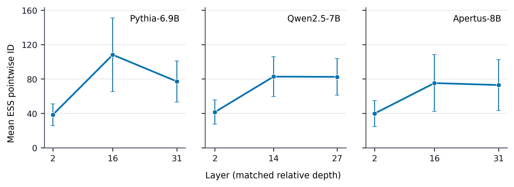
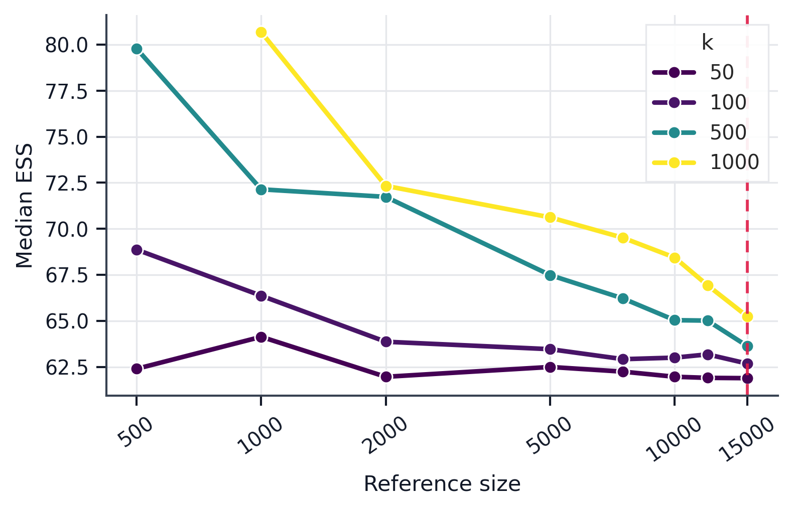
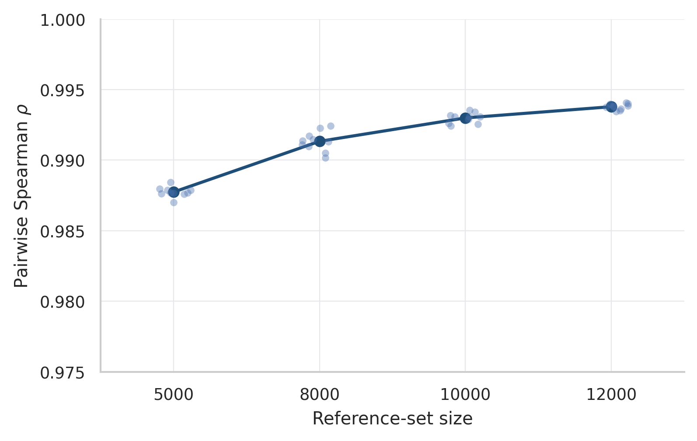
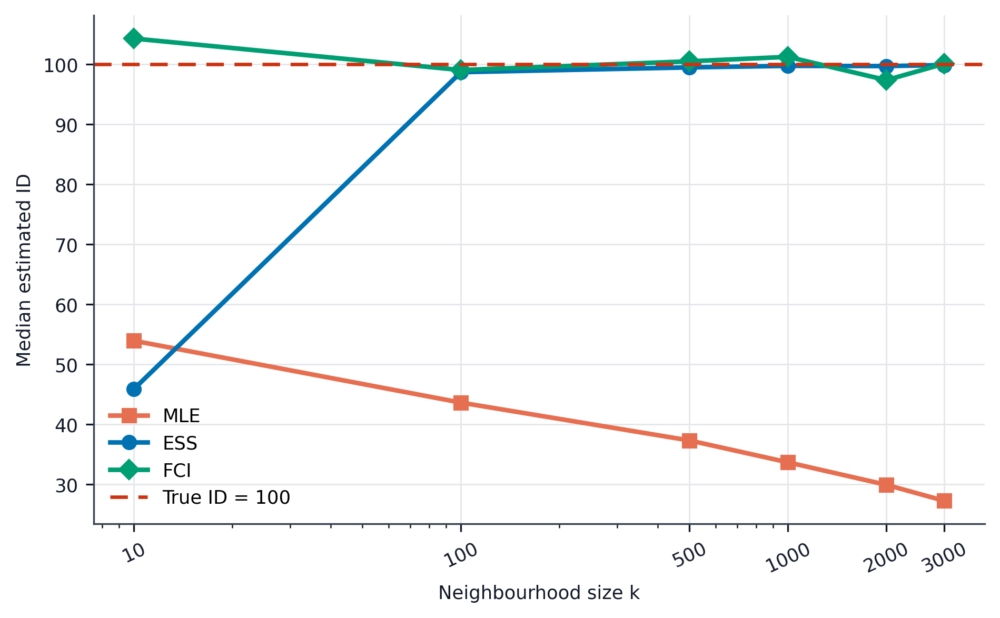
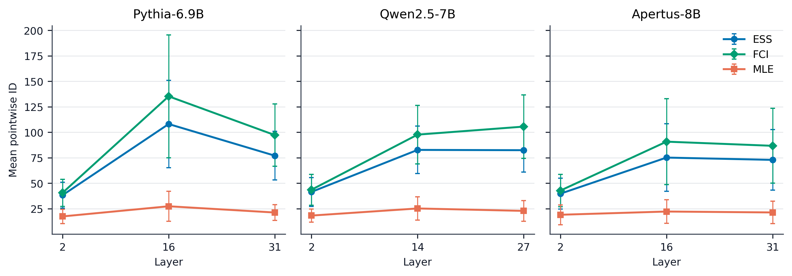
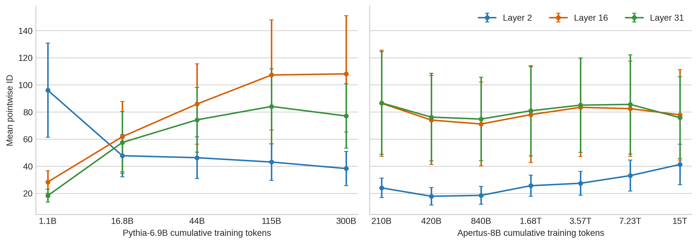
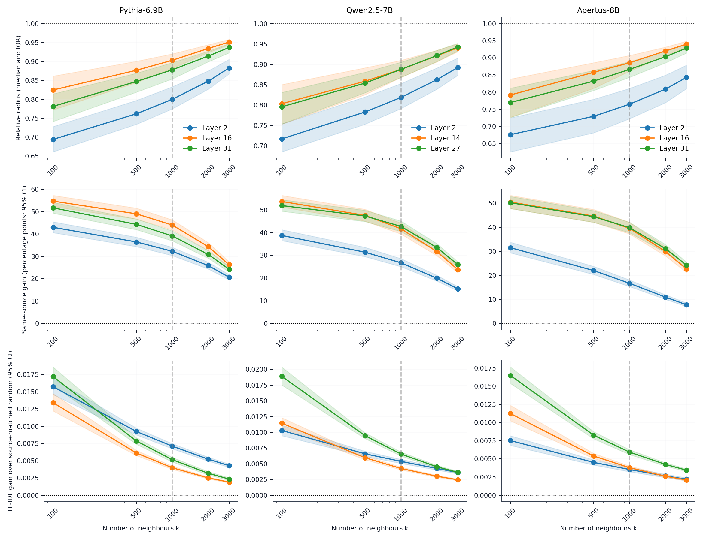
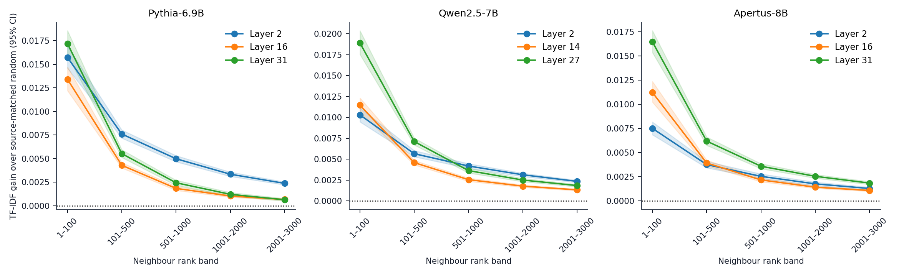
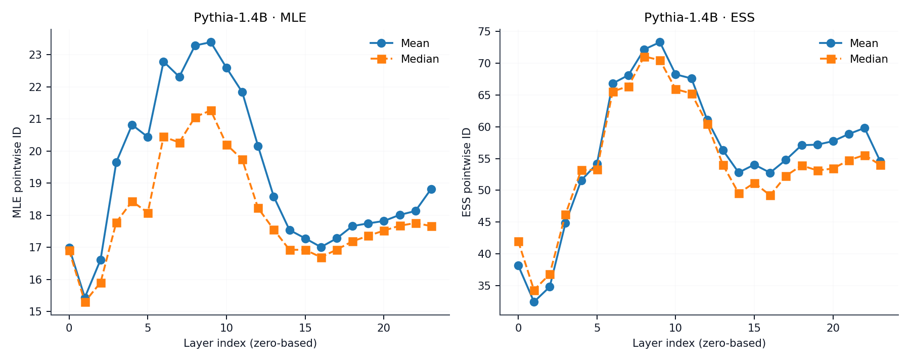

# Figures

The repository keeps a browser-friendly PNG and a vector PDF for every numbered paper figure.

## Figure 1

Mean ESS pointwise ID (±1 SD) across approximately matched relative depths in Pythia, Qwen, and Apertus. This uses the paper-era aggregate; see the artifact map for the pinned Apertus comparison.

[PDF](figures/figure_01.pdf) · [PNG](figures/figure_01.png)

## Figure 2

Sensitivity of median Pythia ESS pointwise ID to reference-set size for four neighbourhood sizes. The archived rows identify layer 12 although the manuscript caption says layer 16.

[PDF](figures/figure_02.pdf) · [PNG](figures/figure_02.png)

## Figure 3

Reference-resampling stability for Pythia layer 16 at k = 1000. Points are pairwise correlations among five sampled reference sets.

[PDF](figures/figure_03.pdf) · [PNG](figures/figure_03.png)

## Figure 4

Gaussian synthetic calibration in D = 100 with 15,000 reference points and 100 queries.

[PDF](figures/figure_04.pdf) · [PNG](figures/figure_04.png)

## Figure 5

Mean pointwise ID (±1 SD) across depth for ESS, FCI, and MLE in all three models.

[PDF](figures/figure_05.pdf) · [PNG](figures/figure_05.png)

## Figure 6

Mean ESS pointwise ID (±1 SD) across Pythia and Apertus training checkpoints.

[PDF](figures/figure_06.pdf) · [PNG](figures/figure_06.png)

## Geometry and control experiments

### Neighbourhood scale and composition across k

[PDF](figures/neighbourhood_locality.pdf) · [PNG](figures/neighbourhood_locality.png)

### Lexical enrichment within separate neighbour-rank bands

[PDF](figures/neighbourhood_lexical_shells.pdf) · [PNG](figures/neighbourhood_lexical_shells.png)

### Pythia-1.4B ID estimates at every transformer layer

[PDF](figures/pythia_small_all_layers.pdf) · [PNG](figures/pythia_small_all_layers.png)

